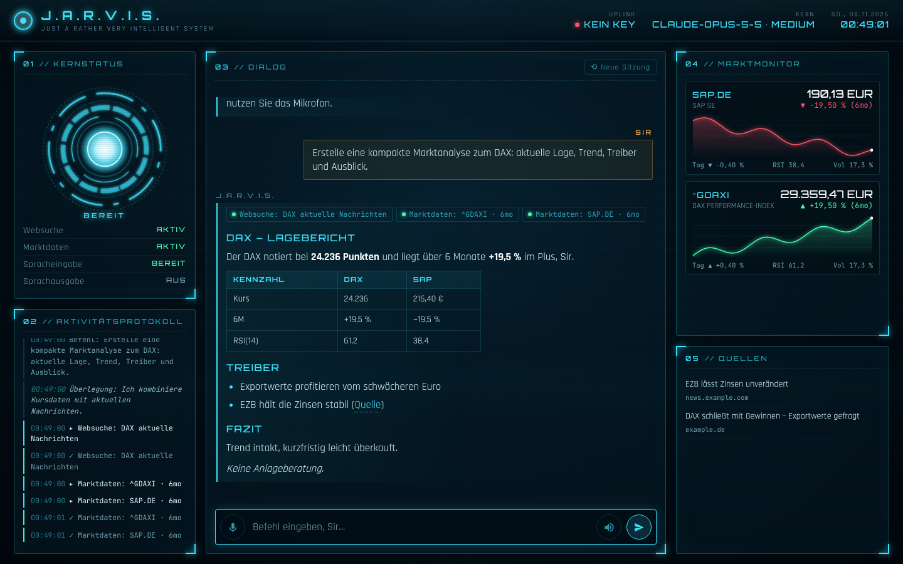

# J.A.R.V.I.S. – KI-Agent mit Iron-Man-HUD

Ein interaktiver KI-Assistent im Stil von Tony Starks JARVIS. Er recherchiert im Web, fasst Nachrichten zusammen
und erstellt Marktanalysen mit Live-Kursdaten – per Tastatur oder Sprache.



## Funktionen

- **Websuche & Seiten lesen** – über Claudes eingebaute Tools `web_search` und `web_fetch`
- **Marktanalyse** – Kursverlauf und Kennzahlen (SMA 20/50/200, RSI 14, Volatilität, Max-Drawdown, Trend) für
  Aktien, Indizes, Devisen, Rohstoffe und Krypto (Yahoo Finance), dazu Ticker-Suche und Krypto-Übersicht (CoinGecko)
- **HUD-Oberfläche** – animierter Arc-Reaktor, der den Zustand zeigt (denkt / sucht / lädt Daten / spricht / hört zu),
  Aktivitätsprotokoll, Marktmonitor mit Charts, Quellenliste, Boot-Sequenz
- **Sprache** – Spracheingabe (Mikrofon, `Strg+M`) und Sprachausgabe auf Deutsch (Browser-Sprach-API, am besten in Chrome/Edge)
- **Gedächtnis pro Sitzung** – Rückfragen wie „und jetzt im Vergleich zu Apple?“ funktionieren
- Live-Streaming der Antworten; läuft auf Desktop und Handy

## Schnellstart

Voraussetzung: Python 3.10+ und ein Anthropic-API-Key ([platform.claude.com](https://platform.claude.com/settings/keys)).

```bash
cd jarvis
cp .env.example .env        # API-Key eintragen
./start.sh                  # legt beim ersten Start eine venv an
```

Dann <http://127.0.0.1:8000> öffnen.

Manuell ohne Skript:

```bash
pip install -r requirements.txt
export ANTHROPIC_API_KEY=sk-ant-...
python server.py
```

Vom Handy im selben WLAN: `HOST=0.0.0.0 ./start.sh` und `http://<IP-des-Rechners>:8000` öffnen
(Spracheingabe braucht im Browser meist HTTPS oder `localhost`).

## Einstellungen (`.env`)

| Variable | Standard | Bedeutung |
|---|---|---|
| `ANTHROPIC_API_KEY` | – | Dein API-Key |
| `JARVIS_MODEL` | `claude-opus-5-5` | Claude-Modell |
| `JARVIS_EFFORT` | `medium` | Denktiefe: `low`, `medium`, `high`, `xhigh`, `max` (höher = gründlicher, langsamer, teurer) |
| `HOST` / `PORT` | `127.0.0.1` / `8000` | Server-Adresse |

## Beispiele

- „Erstelle eine Marktanalyse zu Rheinmetall.“
- „Vergleiche NVIDIA und AMD über ein Jahr als Tabelle.“
- „Wie steht Bitcoin, und was sind die wichtigsten News dazu?“
- „Was sind heute die wichtigsten Wirtschaftsnachrichten?“
- „Fasse mir diese Seite zusammen: https://…“

## Aufbau

```
jarvis/
├── server.py      FastAPI-Server, liefert die Oberfläche, streamt Events per Server-Sent Events
├── agent.py       Agent-Schleife mit der Claude API (Streaming, Tool-Aufrufe, Fehlerbehandlung)
├── tools.py       Eigene Tools: market_data, symbol_search, crypto_overview
└── static/        HUD-Oberfläche (HTML/CSS/JS, keine Build-Schritte)
```

So läuft eine Anfrage ab: Die Oberfläche schickt die Nachricht an `/api/chat`. Der Agent streamt Claudes Antwort;
Websuchen laufen direkt bei Anthropic, eigene Tools (Kursdaten) führt der Server parallel aus und gibt die Ergebnisse
zurück, bis Claude fertig ist. Jeder Schritt erscheint live im HUD.

**Eigenes Tool hinzufügen:** Definition in `CUSTOM_TOOLS` in `tools.py` ergänzen, Eingabe in `validate_input`
prüfen und in `run_custom_tool` ausführen.

## Hinweise

- Yahoo Finance wird über inoffizielle Endpunkte abgefragt; die können sich ändern oder zeitweise drosseln.
- Gesprächsverläufe liegen nur im Arbeitsspeicher und sind nach einem Neustart weg.
- Der Server hat keine Anmeldung – nur lokal oder im vertrauenswürdigen Netz betreiben.
- Die Analysen sind Informationen, keine Anlageberatung.
